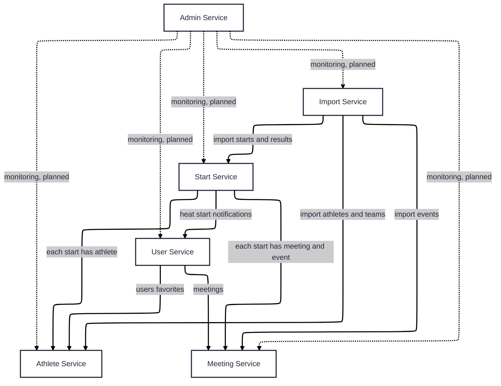

# SwimResults

## Project Structure

<table>
    <thead>
        <tr>
            <th>System</th>
            <th>Description</th>
            <th>Progress</th>
            <th>Status</th>
        </tr>
    </thead>
    <tbody>
        <tr>
            <td colspan=4><b>Frontend and Webpages</b></td>
        </tr>
        <tr>
            <td>WebApplication</td>
            <td>🔗 <a href="https://github.com/SwimResults/WebApplication">Link</a></td>
            <td>🟢</td>
            <td>
                
                <br>
                
                <br>
                
                <!--img alt="Weblate project translated" src="https://img.shields.io/weblate/progress/swimresults?server=https%3A%2F%2Fweblate.swimresults.de&style=flat-square"-->
            </td>
        </tr>
        <tr>
            <td>Homepage</td>
            <td>🔗 <a href="https://github.com/SwimResults/Homepage">Link</a></td>
            <td>🟢</td>
            <td>
                
                <br>
                
                <br>
                
                <!--img alt="Weblate project translated" src="https://img.shields.io/weblate/progress/swimresults?server=https%3A%2F%2Fweblate.swimresults.de&style=flat-square"-->
            </td>
        </tr>
        <tr>
            <td>DownloadPage</td>
            <td>🔗 <a href="https://github.com/SwimResults/DownloadPage">Link</a></td>
            <td>🟢</td>
            <td>
                
                <br>
                
            </td>
        </tr>
        <tr>
            <td>StatusPage</td>
            <td>🔗 <a href="https://github.com/SwimResults/StatusPage">Link</a></td>
            <td>🟡</td>
            <td>
                
                <br>
                
            </td>
        </tr>
        <tr>
            <td>Livestreaming</td>
            <td>🔗 <a href="https://github.com/SwimResults/Livestreaming">Link</a></td>
            <td>🟢</td>
            <td>
                
            </td>
        </tr>
        <tr>
            <td colspan=4><b>Apps</b></td>
        </tr>
        <tr>
            <td>iosApplication</td>
            <td>🔗 <a href="https://github.com/SwimResults/iosApplication">Link</a></td>
            <td>🟢</td>
            <td></td>
        </tr>
        <tr>
            <td>iosManagerApplication</td>
            <td>🔗 <a href="https://github.com/SwimResults/iosManagerApplication">Link</a></td>
            <td>🟡</td>
            <td></td>
        </tr>
        <tr>
            <td>AndroidApplication</td>
            <td>🔗 <a href="https://github.com/SwimResults/AndroidApplication">Link</a></td>
            <td>🟡</td>
            <td></td>
        </tr>
        <tr>
            <td>ManagerApplication</td>
            <td>🔗 <a href="https://github.com/SwimResults/ManagerApplication">Link</a></td>
            <td>🟡</td>
            <td></td>
        </tr>
        <tr>
            <td colspan=4><b>Backend (Microservices)</b></td>
        </tr>
        <tr>
            <td>service-core</td>
            <td>🔗 <a href="https://github.com/SwimResults/service-core">Link</a></td>
            <td>🟢</td>
            <td></td>
        </tr>
        <tr>
            <td>athlete-service</td>
            <td>🔗 <a href="https://github.com/SwimResults/athlete-service">Link</a></td>
            <td>🟢</td>
            <td>
                
            </td>
        </tr>
        <tr>
            <td>start-service</td>
            <td>🔗 <a href="https://github.com/SwimResults/start-service">Link</a></td>
            <td>🟢</td>
            <td></td>
        </tr>
        <tr>
            <td>user-service</td>
            <td>🔗 <a href="https://github.com/SwimResults/user-service">Link</a></td>
            <td>🟢</td>
            <td></td>
        </tr>
        <tr>
            <td>import-service</td>
            <td>🔗 <a href="https://github.com/SwimResults/import-service">Link</a></td>
            <td>🟢</td>
            <td></td>
        </tr>
        <tr>
            <td>meeting-service</td>
            <td>🔗 <a href="https://github.com/SwimResults/meeting-service">Link</a></td>
            <td>🟢</td>
            <td></td>
        </tr>
        <tr>
            <td>admin-service</td>
            <td>🔗 <a href="https://github.com/SwimResults/admin-service">Link</a></td>
            <td>🟡</td>
            <td></td>
        </tr>
    </tbody>
</table>

**Status:**
🟢 Done
🟡 Under Development
🔴 Open


## Workspace

This repository is also the root of the SwimResults development workspace: every project above is cloned into
`server/` or `client/` (each is its own git repo, ignored here).

```sh
git clone https://github.com/SwimResults/SwimResults.git swimresults && cd swimresults
scripts/ws.sh clone        # clone all repos (scripts/repos.txt)
scripts/ws.sh status       # branch / dirty state of every repo
cp dev/.env.example dev/.env && docker compose -f dev/docker-compose.yml up --build   # local backend on :8090
```

- [docs/architecture.md](docs/architecture.md): system overview, routing, who calls whom, auth, data
- [docs/repos.md](docs/repos.md): build/run/test commands and code layout per repo
- [AGENTS.md](AGENTS.md): conventions for working across repos

## Infrastructure

### Microservices



Arrows are direct HTTP calls via the Go clients each service exports. Details: [docs/architecture.md](docs/architecture.md).
