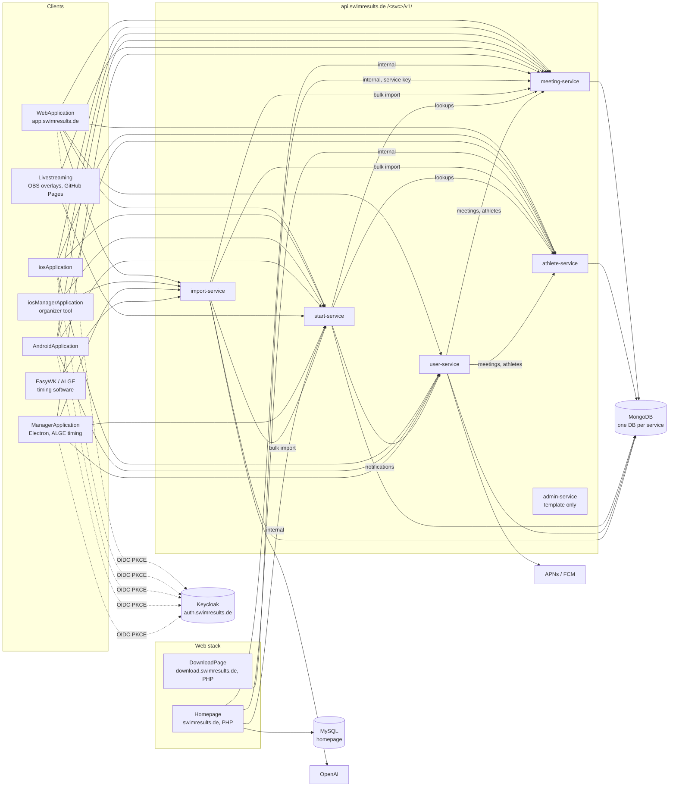

# SwimResults Architecture

State as of 2026-11 (reviewed from source). Security-sensitive findings and server details are tracked in the
private `SwimResults/infrastructure` repo, not here.

## System overview



## Request routing

```
Internet ─► outer nginx (SSL, certificates, domain matching)            [separate stack, not in git]
             ├─ swimresults.de           ─► web stack: homepage (PHP/Apache)
             ├─ app.swimresults.de       ─► web stack: WebApplication (nginx, static Angular)
             ├─ download.swimresults.de  ─► web stack: DownloadPage
             ├─ status.swimresults.de    ─► web stack: StatusPage
             ├─ auth.swimresults.de      ─► Keycloak
             ├─ weblate.swimresults.de   ─► Weblate
             └─ api.swimresults.de       ─► /<svc>/v1/<route> → sr_microservice_productive_<svc>_service:8080/<route>
                api-dev.swimresults.de   ─► /<svc>/v1/<route> → sr_microservice_development_<svc>_service:8080/<route>
```

- The outer nginx routes the API hosts **directly** to the Swarm services; the environment is chosen by host name.
  Routed services: athlete, start, import, user, meeting.
- CORS allows `https://*.swimresults.de`, `http://localhost:*` and `https://swimresults.github.io` (Livestreaming).
- SSE-friendly proxying (no buffering, 1 h timeouts) for import-service progress streams; max body 50 MB.
- Services serve their routes **at the root** (no `/v1`); the `/<svc>/v1/` prefix is added only by the gateway.
- Locally, `dev/docker-compose.yml` runs the same routing at `http://localhost:8090/<svc>/v1/`.
- Branches → images → environments: `master` → `ghcr.io/swimresults/<repo>:master` → prod; `develop` → `:develop` → dev.
- Internally, services reach each other via `http://<svc>-service:8080/` on the Swarm services network.

## Who calls whom

### Apps → services

| Consumer | meeting | athlete | start | user | import |
|---|---|---|---|---|---|
| WebApplication | meetings, events (+parts, livetiming, certification), files, incidents | athletes, teams, certificates, amounts | starts, results, heats (current, event_list, info), `POST heat/:id/time` | user, follow/me, dashboards, `notification/meet/:m`, reports | `easywk/v3`, `file`, `pdf_to_text` |
| iosApplication | meetings, events (+parts), incidents | athletes, teams, certificates, `POST athlete/meet/:m/id_list` | starts, results, heats | user, follow/me, notification_user (register APNs), report | – |
| iosManagerApplication | meetings, events, `POST event/meet/:m/event/:n/certification` | – | heats by event, `POST heat/:id/time`, `POST heat/meet/:m/events/start_estimation_date`, `DELETE heat\|start/meet/:m/event/:e` | – | `file`, `pdf_to_text` |
| AndroidApplication | meetings, events (+parts), incidents | athletes, teams (+search) | starts, results, heats | user, follow/me, notification_user (register FCM), report | – |
| ManagerApplication | meetings, events, files, incidents | – | starts, heats | user (me) | `alge` (ALGE live timing), `file` + SSE progress |
| Livestreaming | `event/meet/:m/event/:n` | – | `start/meet/:m/current`, `heat/meet/:m/current`, `heat/meet/:m/event/:e/info` | – | – |
| Homepage (internal) | `GET meeting` | `GET athlete/amount` | `GET start/amount` | – | – |
| DownloadPage (internal) | `POST file/increment` | – | – | – | – |
| EasyWK / ALGE | – | – | – | – | `/easywk/*`, `/alge` |

Full endpoint lists with parameters, permissions and schemas: the OpenAPI specs in
[SwimResults/swimresults-api](https://github.com/SwimResults/swimresults-api/tree/master/specs)
(drift-checked against the controllers).

### Service → service

All calls use typed Go clients exported from the **target** repo's `client/` package, built on
`service-core/client` (adds `X-Swimresults-Service: $SR_SERVICE_KEY`). The user's token is not forwarded.

| Caller | Target (client version pinned in go.mod) | Used for | Base URL env |
|---|---|---|---|
| import-service | meeting-service v0.10.0 | `event/import`, `event/meet/…`, `age_group/…` | `SR_IMPORT_MEETING_URL` |
| import-service | athlete-service v0.4.0 | `athlete/import`, `team/import`, `certificate/import`, lookups | `SR_IMPORT_ATHLETE_URL` |
| import-service | start-service v0.7.4 | `start/import`, `result/import`, `heat/import`, `disqualification/import`, `ranking/import`, `rank/import` | `SR_IMPORT_START_URL` |
| start-service | athlete-service v0.3.0 | athlete by name+year, team by name | `SR_START_ATHLETE_URL` |
| start-service | meeting-service v0.9.1 | events of a meeting | `SR_START_MEETING_URL` |
| start-service | user-service v0.2.0 | heat-start notifications, meeting broadcasts | `SR_START_USER_URL` |
| user-service | meeting-service v0.8.0 | meetings (cached at startup) | `SR_USER_MEETING_URL` |
| user-service | athlete-service v0.3.0 | athletes | `SR_USER_ATHLETE_URL` |

athlete-, meeting- and admin-service call no other service. Note the version skew: three consumers pin three
different meeting-service client versions.

### External

Keycloak (all apps), APNs + FCM (user-service), OpenAI (import-service certificate naming), GitHub GraphQL +
Gravatar (Homepage), `qpdf` (import-service).

## Auth model

- **Keycloak** realm `swimresults` at `https://auth.swimresults.de/realms/swimresults`.
  Public PKCE clients: `swimresults-pkce-client` (web and the Electron ManagerApplication), `ios-pkce-client` (both iOS
  apps; redirects `swimresults://oauth2redirect/keycloak-provider` and
  `de.logilutions.swimresultsmanager://oauth2redirect/keycloak-provider`), `android-pkce-client`.
- **Services** (via `service-core/security`): RS256 JWT verified against a static realm public key
  (`SR_JWT_PUBLIC_KEY`, fallback `SR_KEYCLOAK_PUBLIC_KEY`). Permission levels per route:
  `public` · `admin` (realm role `admin`) · `manager` (role `manager` or admin, any meeting) ·
  `meeting` (admin, or manager whose token `events` claim contains the meeting id, read from `meet_id`/`meetid`/`meeting`
  in path, query or body).
- **Service-to-service:** shared key header `X-Swimresults-Service`.
- **WebApplication UI** checks OAuth *scopes* (`root`, `speaker`), not realm roles — keep in mind when changing roles.

## Data

| Store | Owner | Contents |
|---|---|---|
| MongoDB `meeting` | meeting-service | meeting, meeting_series, location, style, event, file, incident, age_group (deprecated) |
| MongoDB `athlete` | athlete-service | athlete, team, certificate |
| MongoDB `start` | start-service | start (incl. results/ranks), heat, disqualification, registration, ranking |
| MongoDB `user` | user-service | user, notification_user, dashboard, widget, config, report |
| MongoDB `import` | import-service | settings (PDF import settings) |
| MongoDB `admin` | admin-service | example (template) |
| MySQL `sr_website` | Homepage | blog, quizzes, quiz_sessions, quiz_results |
| Files volume | import-service, DownloadPage, SFTP | `files/<MEETING>/…` (protocols, lists, import uploads, club FTP uploads) |

## Configuration conventions

- Service env vars are `SR_<SVC>_*`: `SR_<SVC>_PORT`, `SR_<SVC>_MONGO_{HOST,PORT,USERNAME,PASSWORD,DATABASE}`,
  `SR_<SVC>_<TARGET>_URL` (with trailing `/`), plus shared `SR_SERVICE_KEY`, `SR_JWT_PUBLIC_KEY`, `TZ=Europe/Berlin`.
- No service has code defaults; a missing `SR_<SVC>_PORT` exits, a missing target URL leaves a nil client.
- Health: `GET /actuator` → `OPERATIONAL` | `DATABASE_DISCONNECTED`. Metrics: `GET /metrics` (Prometheus).

## Known contract drift (to be fixed via shared specs)

- Generated clients from swimresults-api replace the hand-written models in the Go services, Web and
  ManagerApplication (via `@swimresults/angular`), both iOS apps and Android. Some of these migrations are still open
  PRs. Homepage, DownloadPage and Livestreaming still use implicit, hand-written models.
- Go client versions differ per consumer (see table above).
- `user-service` `NotificationClient.SendNotification` posts to `notification/import`, which isn't served.
- start-service `POST heat/:id/time` uses the `meeting` permission but has no meeting id in path, query or body.
  The check therefore always fails for managers, and only admins can edit heat times (WebApplication, iosManagerApplication).
- WebApplication dev JWT interceptor only matches `localhost:8090`; its direct-port dev URLs get no token (use the local gateway).
- Livestreaming relies on fields such as `results[].result_type` values `livetiming_result`/`registration`,
  `heat.start_at/finished_at`, `event.style.name`, `event.final.is_final`; Homepage relies on `athlete/amount` and
  `start/amount` returning a bare JSON integer.
- Paging: `limit` defaults to 0 (= unlimited in Mongo) in athlete-service.
